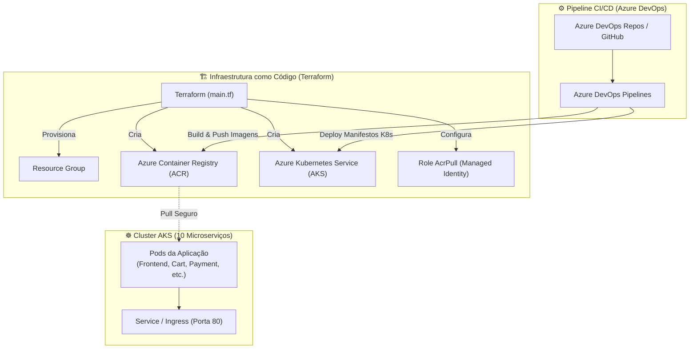

# 🛍️ Online Boutique - Azure DevOps + Terraform + AKS + ACR

Implementação de ponta a ponta de cultura e engenharia **DevOps na nuvem Microsoft Azure**, provisionando infraestrutura como código com **Terraform**, orquestração de microserviços no **Azure Kubernetes Service (AKS)**, registro seguro no **Azure Container Registry (ACR)** e pipelines de CI/CD automatizados via **Azure DevOps**.

---

## 🚀 Visão Geral da Arquitetura

O projeto implanta a renomada aplicação de demonstração de microserviços **Google Online Boutique** em um cluster Kubernetes gerenciado na nuvem Azure, otimizado para custo reduzido em ambiente de laboratório/demonstração:



---

## 🛠️ Tecnologias Utilizadas

| Componente | Tecnologia | Finalidade |
|---|---|---|
| **Cloud Provider** | Microsoft Azure | Provedor de nuvem para hosting da infraestrutura |
| **Infraestrutura como Código** | Terraform (azurerm provider) | Provisionamento automatizado e idempotente do ACR e AKS |
| **Orquestrador de Containers** | Azure Kubernetes Service (AKS) | Gerenciamento e escalabilidade dos microserviços |
| **Registro de Imagens** | Azure Container Registry (ACR) | Armazenamento privado das imagens Docker dos serviços |
| **Automação de CI/CD** | Azure DevOps Pipelines | Automação contínua de integração, testes e deploy |
| **Aplicação** | Google Online Boutique | 10 microserviços poliglotas (Go, C#, Node.js, Python, Java) |
| **Desenvolvimento Local** | Docker Compose | Execução e testes rápidos dos serviços em ambiente local |

---

## 🧩 Os 10 Microserviços Poliglotas

A aplicação simula uma plataforma de e-commerce real desacoplada em 10 serviços especializados:

| Microserviço | Linguagem | Responsabilidade |
|---|---|---|
| `frontend` | Go | Interface web do usuário e proxy para os demais serviços |
| `cartservice` | C# (.NET Core) | Armazenamento e manipulação do carrinho de compras |
| `productcatalogservice` | Go | Catálogo de produtos, busca e detalhes de itens |
| `currencyservice` | Node.js | Conversão de moedas em tempo real |
| `paymentservice` | Node.js | Processamento e validação de pagamentos com cartão |
| `shippingservice` | Go | Cálculo de frete e estimativas de envio |
| `emailservice` | Python | Confirmação e envio de comprovantes de pedidos |
| `checkoutservice` | Go | Orquestrador de checkout, cobrança e despacho |
| `recommendationservice`| Python | Mecanismo de recomendação de produtos com IA/regras |
| `adservice` | Java | Exibição de anúncios contextualizados |

---

## 📂 Estrutura do Repositório

```text
az-devops-onlineboutique/
├── terraform/                # Código de Infraestrutura como Código (IaC)
│   ├── main.tf               # Definição do ACR, Cluster AKS e permissão AcrPull
│   ├── variables.tf          # Variáveis parametrizáveis (região, tamanhos, nós)
│   ├── outputs.tf            # Saídas úteis (FQDN do ACR, credenciais do cluster)
│   └── README.md             # Documentação específica de Terraform
├── DEPLOY.md                 # Guia detalhado passo a passo de deploy na Azure
├── docker-compose-local.yml   # Manifesto para execução dos microserviços localmente
├── build-and-push.sh         # Script utilitário para build e envio ao ACR
├── start-local.sh            # Inicialização rápida da stack local (porta 9090)
├── stop-local.sh             # Finalização da stack local
├── start_monitor.sh          # Script de monitoramento contínuo dos pods no AKS
├── stop_monitor.sh           # Parada do script de monitoramento
├── .gitignore                # Proteção e exclusão de binários pesados e estados locais
└── README.md                 # Documentação principal
```

---

## ⚙️ Como Executar

### Pré-requisitos
- [Azure CLI (`az`)](https://learn.microsoft.com/pt-br/cli/azure/install-azure-cli) instalado e autenticado (`az login`)
- [Terraform 1.0+](https://www.terraform.io/) instalado
- [kubectl](https://kubernetes.io/docs/tasks/tools/) instalado
- [Docker](https://www.docker.com/) (para testes locais)

---

### Opção 1: Teste Rápido Local (Docker Compose)

Para testar a aplicação na sua máquina sem gastar créditos na nuvem:

```bash
# Iniciar a aplicação localmente
chmod +x start-local.sh stop-local.sh
./start-local.sh
```
Acesse no navegador: **[http://localhost:9090](http://localhost:9090)**

Para encerrar a execução local:
```bash
./stop-local.sh
```

---

### Opção 2: Provisionamento Completo na Azure

#### 1. Criar a Infraestrutura com Terraform
```bash
cd terraform
terraform init
terraform plan
terraform apply -auto-approve
```

#### 2. Obter as Credenciais do Cluster AKS
```bash
az aks get-credentials --resource-group meu-resource-group --name online-boutique-aks
```

#### 3. Realizar o Deploy dos Microserviços
Siga o passo a passo completo e detalhado documentado em **[DEPLOY.md](DEPLOY.md)** para configuração das pipelines no Azure DevOps ou aplicação direta dos manifestos Kubernetes:
```bash
kubectl apply -f release/kubernetes-manifests.yaml
```

#### 4. Monitoramento dos Pods
Você pode acompanhar a estabilização e subida dos pods com o script utilitário:
```bash
chmod +x start_monitor.sh stop_monitor.sh
./start_monitor.sh
```

---

## 💰 Estimativa de Custo na Azure (Otimizado para Lab)

A infraestrutura foi dimensionada para testes com orçamento reduzido:
- **Azure Container Registry (SKU Basic):** ~$0.17/dia
- **AKS (1 nó Standard_B2s burstable):** ~$1.00/dia
- **Total estimado:** Apenas **~$1.20 por dia** durante os testes (podendo ser destruído após o uso com `terraform destroy`).

---

## 👤 Autor

Desenvolvido por **[Igor Paiva](https://github.com/igorpaiva26)**.  
*Aplicação baseada no projeto opensource Google Cloud Microservices Demo com arquitetura cloud adaptada para Microsoft Azure e Azure DevOps.*
